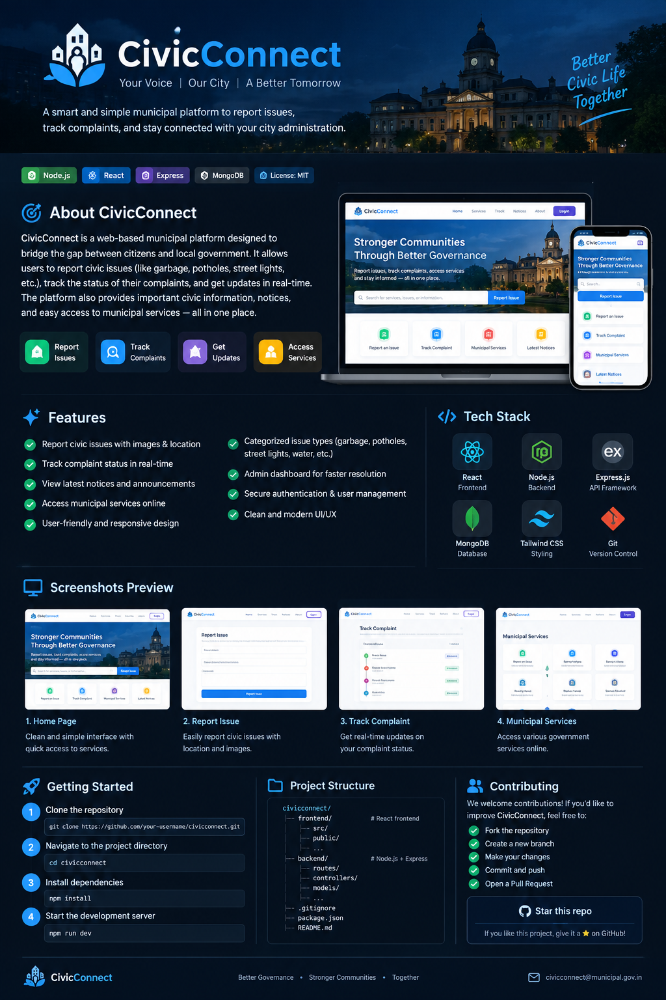
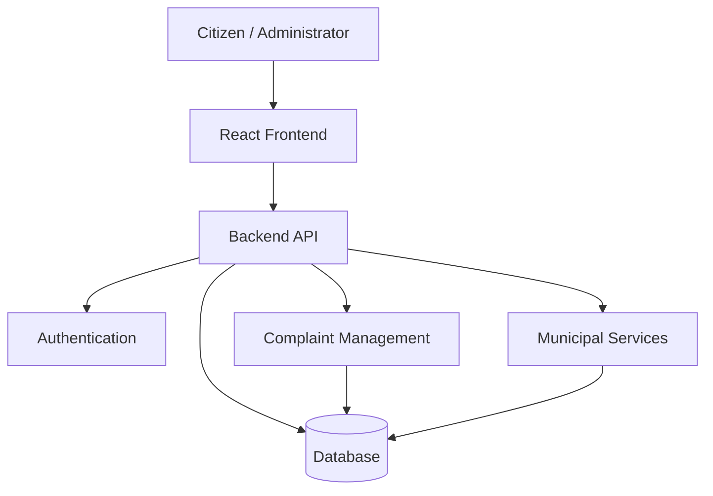

</div>
<div align="center">

  

  <h1>🏙️ CivicConnect</h1>

  <h3>Your Voice | Our City | A Better Tomorrow</h3>

  <p>
    <b>A Smart Municipal Grievance Redressal & Civic Services Platform</b>
  </p>

  <p>
    Empowering citizens to report civic issues, track complaints,
    access municipal services, and build better communities.
  </p>

  <p>
    <a href="#-features">Features</a> •
    <a href="#-tech-stack">Tech Stack</a> •
    <a href="#-installation--setup">Installation</a> •
    <a href="#-project-structure">Structure</a> •
    <a href="#-contributing">Contributing</a>
  </p>

  
  
  

</div>

---

## 📑 Table of Contents

- [🌆 About the Project](#-about-the-project)
- [🎯 Problem Statement](#-problem-statement)
- [💡 Our Solution](#-our-solution)
- [✨ Features](#-features)
- [🖥️ Screenshots](#️-screenshots)
- [🛠️ Tech Stack](#️-tech-stack)
- [🏗️ System Architecture](#️-system-architecture)
- [📂 Project Structure](#-project-structure)
- [⚙️ Installation & Setup](#️-installation--setup)
- [🔐 Environment Variables](#-environment-variables)
- [🚀 Future Enhancements](#-future-enhancements)
- [🤝 Contributing](#-contributing)
- [👨‍💻 Author](#-author)
- [📜 License](#-license)

---

## 🌆 About the Project

**CivicConnect** is a web-based municipal platform designed to strengthen communication between citizens and local government authorities.

In many cities, residents face difficulties reporting everyday civic problems such as garbage accumulation, damaged roads, drainage issues, streetlight failures, and sanitation concerns. Tracking complaints and finding the right municipal services can also be challenging.

CivicConnect aims to provide a centralized digital platform where citizens can raise concerns, follow complaint progress, discover civic services, and stay informed about municipal announcements.

### 🌟 Our Vision

> Building smarter cities through digital participation, transparent communication, and citizen-driven governance.

### 🎯 Our Mission

To make municipal services more accessible, civic reporting more convenient, and communication between citizens and local authorities more effective.

---

## 🎯 Problem Statement

Traditional municipal grievance systems can involve several challenges:

- 📍 Difficulty identifying the appropriate authority for an issue.
- 📝 Time-consuming complaint submission processes.
- 🔎 Limited visibility into complaint progress.
- 📢 Difficulty finding important municipal notices.
- 🏘️ Lack of a centralized platform for common civic services.
- 🤝 Limited digital engagement between citizens and local administration.

CivicConnect is designed to address these challenges through a convenient and organized web experience.

---

## 💡 Our Solution

CivicConnect brings important civic activities together in one platform.

| Civic Need | Proposed Solution |
|---|---|
| Report local problems | Online civic complaint submission |
| Follow complaints | Complaint status and progress tracking |
| Find public services | Centralized municipal services directory |
| Stay informed | Municipal notices and announcements |
| Improve accountability | Organized complaint records for review |
| Simplify access | Responsive, user-friendly interface |

---

## ✨ Features

### 📝 1. Civic Issue Reporting
- Submit complaints about local civic problems.
- Choose an appropriate issue category.
- Provide a description and relevant details.
- Support for location and image uploads where implemented.

### 📍 2. Complaint Tracking
- Check the status of submitted complaints.
- Follow progress through the complaint workflow.
- Help citizens understand the progress of their requests.

### 🏛️ 3. Municipal Services
- Explore available municipal services.
- Access relevant civic information in one place.
- Make common public-service information easier to find.

### 📢 4. Notices & Announcements
- Display important municipal updates.
- Share public announcements and community information.
- Help citizens stay informed about local developments.

### 👤 5. User-Friendly Interface
- Modern and intuitive web design.
- Organized navigation and accessible layouts.
- Responsive experience for desktop and mobile screens.

### 🔒 6. Account & Administration
- User authentication and account management, if implemented.
- Administrative complaint management, if implemented.
- Role-based access controls, where configured.

---

## 🖥️ Screenshots

Add actual screenshots of your running website to the `assets/screenshots/` folder and update the image paths below.

### 🏠 Home Page

<div align="center">
  
  <p><i>The main dashboard for exploring civic services and reporting issues.</i></p>
</div>

### 📝 Report a Civic Issue

<div align="center">
  
  <p><i>A simple interface for submitting civic complaints.</i></p>
</div>

### 📍 Track a Complaint

<div align="center">
  
  <p><i>Follow the progress of a submitted complaint.</i></p>
</div>

### 🏛️ Municipal Services

<div align="center">
  
  <p><i>Explore municipal services and civic information.</i></p>
</div>

> **Note:** These screenshot paths are placeholders. Replace them with screenshots that exist in your repository; otherwise, GitHub will show broken images.

---

## 🛠️ Tech Stack

Update this section to match the technologies actually used in your project.

<div align="center">

  

</div>

| Technology | Purpose |
|---|---|
| React | Building reusable user-interface components |
| TypeScript | Type-safe frontend development |
| Vite | Frontend development and build tooling |
| Node.js | JavaScript runtime for server-side development |
| Express.js | Backend API framework |
| MongoDB | Database for application data |
| Tailwind CSS | Utility-first styling, if configured |
| Git & GitHub | Version control and collaboration |
| VS Code | Development environment |

**Important:** Keep only the technologies and integrations present in your actual project.

---

## 🏗️ System Architecture

The following is a conceptual architecture for a full-stack CivicConnect application. Adapt it to your actual implementation.



### 🔄 Application Workflow

1. Citizens open the CivicConnect website.
2. They explore services or submit a civic complaint.
3. The frontend sends requests to the backend API, when available.
4. The backend validates and processes requests.
5. Complaint information is stored and retrieved from the database, if configured.
6. Users can view the latest available complaint status.

---

## 📂 Project Structure

Your actual directory structure may differ. A typical full-stack structure could look like this:

```text
civicconnect/
│
├── frontend/
│   ├── public/
│   ├── src/
│   │   ├── components/
│   │   ├── pages/
│   │   ├── assets/
│   │   ├── styles/
│   │   ├── App.tsx
│   │   └── main.tsx
│   ├── package.json
│   └── vite.config.ts
│
├── backend/
│   ├── routes/
│   ├── controllers/
│   ├── models/
│   ├── middleware/
│   ├── server.js
│   └── package.json
│
├── assets/
│   ├── civicconnect-banner.png
│   └── screenshots/
│
├── .gitignore
└── README.md
```

> This is an example structure, not a claim about your current files. Preserve your existing structure and adjust this documentation accordingly.

---

## ⚙️ Installation & Setup

Follow the steps that match the folders and scripts in your repository.

### Prerequisites

Install the following tools if required by your project:

- [Node.js](https://nodejs.org/)
- npm, included with Node.js
- [Git](https://git-scm.com/)
- [Visual Studio Code](https://code.visualstudio.com/)

### Step 1: Clone the repository

```bash
git clone https://github.com/luckyluckybaliyan-wq/civic-sentiment.git
```

### Step 2: Navigate to the project

```bash
cd civic-sentiment/civicconnect
```

If your `frontend` directory is inside `civicconnect`, continue with the next step.

### Step 3: Install frontend dependencies

```bash
cd frontend
npm install
```

### Step 4: Start the frontend

```bash
npm run dev
```

Open the local URL displayed in your terminal, usually `http://localhost:5173` for a default Vite setup.

### Step 5: Start the backend, if available

Open a second terminal and navigate to your backend directory.

```bash
cd backend
npm install
npm run dev
```

Use the actual script configured in your backend's `package.json`. If the project has no backend yet, you can skip this step.

---

## 🔐 Environment Variables

If your application uses environment variables, create the appropriate local environment file using the names expected by your code.

Example for a backend:

```env
PORT=5000
MONGODB_URI=your_database_connection_string
JWT_SECRET=your_long_random_secret
```

These are examples only. Configure the variables your application actually requires.

**Security best practices:**
- Never commit real passwords, database credentials, or secret keys.
- Add environment files such as `.env` to `.gitignore`.
- Keep a safe `.env.example` containing placeholder values.
- Never expose backend secrets in frontend code.

---

## 🚀 Future Enhancements

Potential improvements for future versions include:

- 🗺️ Interactive maps for locating civic issues.
- 📸 Photo attachments for complaint evidence.
- 🔔 Notifications when complaint statuses change.
- 📊 Analytics dashboard for municipal administrators.
- 🌐 Multilingual support for local communities.
- ♿ Improved accessibility for all citizens.
- 📱 Progressive Web App support.
- 🤖 AI-assisted complaint categorization.
- 📈 Reports showing issue categories and resolution trends.
- 🔍 Search and filtering for complaints and services.

These are proposed enhancements, not necessarily existing features.

---

## 🤝 Contributing

Contributions and suggestions are welcome!

### How to Contribute

1. Fork this repository.
2. Create a feature branch.
3. Make your changes.
4. Test your implementation.
5. Commit your changes.
6. Push the branch to your fork.
7. Open a Pull Request.

Example:

```bash
git checkout -b feature/your-feature
git add .
git commit -m "Add your feature"
git push origin feature/your-feature
```

Please keep contributions focused, well documented, and consistent with the project's existing code.

---

## 🛡️ Responsible Use

CivicConnect is intended to support constructive civic participation.

- Submit accurate and relevant information.
- Avoid sharing sensitive personal information in public complaints.
- Respect the privacy of other citizens.
- Protect credentials and confidential application data.
- Use the platform responsibly.

---

## 👨‍💻 Author

<div align="center">

  <h3>Lucky Baliyan</h3>

  <p>B.Tech Student | Computer Science & Information Technology</p>

  <a href="https://github.com/luckyluckybaliyan-wq">
    
  </a>

  <a href="https://github.com/luckyluckybaliyan-wq/civic-sentiment">
    
  </a>

</div>

---

## 📜 License

This project is intended for educational and development purposes.

If you want others to reuse, modify, or distribute your code, choose an appropriate open-source license and include its text in a `LICENSE` file. The MIT License is one common option.

---

<div align="center">

  <h3>🏙️ CivicConnect</h3>

  <p><b>Better Governance • Stronger Communities • A Better Tomorrow</b></p>

  <p>Built with ❤️ to make civic engagement simpler and more accessible.</p>

  <sub>If you find this project useful, consider giving the repository a ⭐ on GitHub.</sub>

</div>
